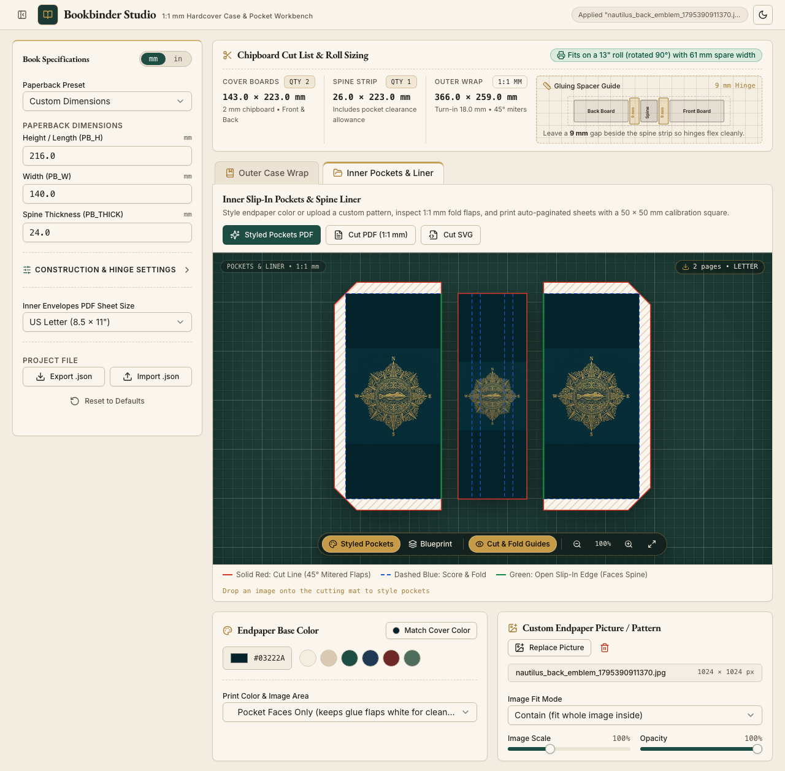
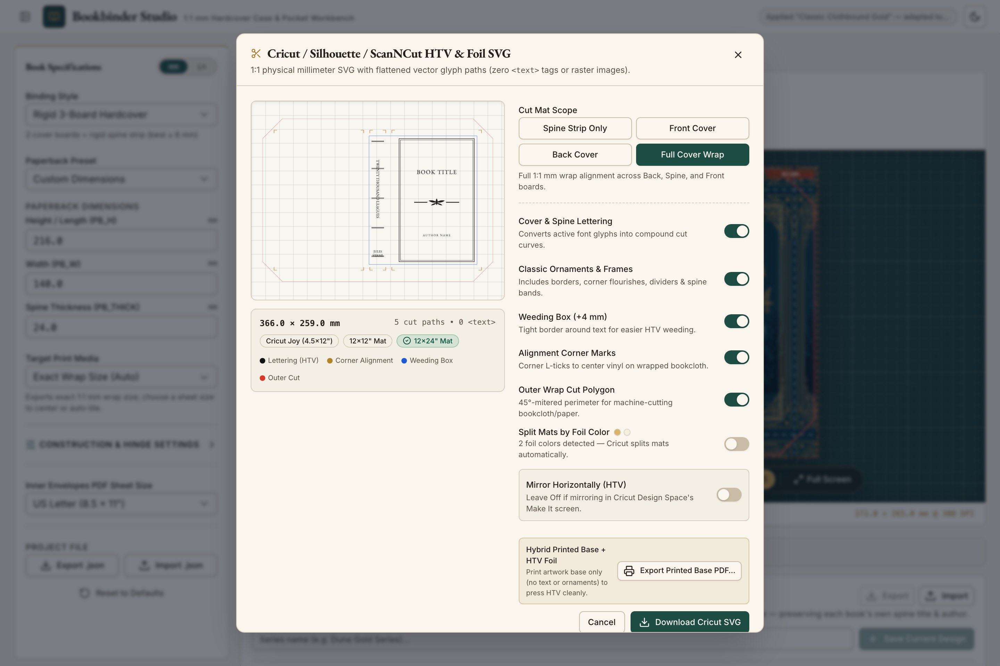

# Bookbinder Studio

Design and print removable hardcover cases, flexible-spine covers, 1-piece fold-and-glue slip covers, classic dust jackets, replacement paperback covers, matching inner pockets or folded glue-in endpapers, slipcase boxes, and Cricut HTV foil SVGs—all right in your browser. No accounts, no subscriptions, and nothing ever leaves your device.

**[Launch Bookbinder Studio →](https://anujgtm.com/Bookbinder/)**


## What You Can Make

| Cover Style | Chipboard | Flaps / Inner Pockets | Best For |
| --- | --- | --- | --- |
| **Rigid 3-Board Hardcover** | Front, Back & Spine boards (`9 mm` hinges) | Removable slip-in pockets **or** folded glue-in endpapers + spine liner | Removable heirloom hardcovers or traditional case rebinds (`≥ 8 mm` spines) |
| **Flexible-Spine 2-Board** | Front & Back boards + cloth spine gap | Removable slip-in pockets **or** folded glue-in endpapers + spine liner | Thin `3–8 mm` notebooks & chapbooks that open completely flat |
| **Fold-and-Glue Slip Cover** | None (`0` boards) | Built-in `20–65 mm` flaps **or** **Separate Glue-In Pockets (2-Sheet)** + 4 wrap-over glue tabs | 1-piece printable slip covers or seamless 2-sheet home prints (zero tape seam on `1× US Letter / A4` + detached fore-edge pockets on Page 2) |
| **Classic Dust Jacket** | None (`0` boards) | Adjustable `20–100 mm` fold-in flaps (no glue) | Publisher-style wrap-around dust jackets with 4 vertical score folds |
| **Replacement Paperback Cover** | None (`0` boards) | Flush trim (none needed) | 1-piece cardstock wraps (`Back + Spine + Front`) glued directly onto a paperback textblock spine |

## Measure & Cut Blueprint

- **Book Presets & Units** — Enter custom dimensions with a `mm` / `in` toggle, or start from built-in presets for **A6**, **Mass Market**, **Manga B6**, and **US Trade**.
- **Chipboard Cut Lists & Diagrams** — Exact board measurements, score stops, material guidance, and visual gluing/folding diagrams tailored to each binding style.
- **Printable Bench Recipe Card & Cutting Jigs PDF** — Export a clean bench-side spec card with your chipboard cut list, assembly checklist, and cut-out **scrap-chipboard jigs** (exact-width hinge spacer strips and a 45° corner miter gauge).
- **Matching Slipcase Box Calculator** — Expand the built-in slipcase calculator to compute a 5-panel chipboard cut list directly from your finished hardcover dimensions, adjust slide clearance and thumb-notch radius live, and export ready-to-cut **Slipcase SVG** and **PDF** templates.
- **Smart Flap-Depth Guardrails** — Live recommended minimum flap depth beside the flap slider (`≥ 35%` / `35 mm` floor for glued Slip Covers; `≥ 45%` / `45 mm` floor for unglued Dust Jackets) with 1-click **Fit Letter**, **Fit A4**, **Deep (38 mm)**, and **Classic (70 mm)** presets.
- **Paper & Roll Fit Checks** — Instantly see whether your wrap fits **US Letter (`8.5 × 11"`)**, **A4 (`210 × 297 mm`)**, **US Legal (`8.5 × 14"`)**, **Tabloid (`11 × 17"`)**, **`13"–44"`** rolls, or any **Custom Roll Width** with live `1 sheet` vs. `2 sheets (tiled)` fit badges.
- **Cutting Blueprint** — Manual cutting dimension chains, a cumulative steel-ruler datum strip, **45° corner miter** callouts, **grain direction arrows**, and **3-Piece Quarter-Bound Split Mode** for wider wraps.


## Cover Design Studio

- **3-Column Bindery Workbench (Light & Dark Modes)** — Style on a warm walnut desk with a left **Spec Ledger**, center cutting-mat stage, docked right **Design Inspector**, and switchable Light (washi paper) and Dark (woven linen) themes—or expand any canvas into **Full Screen** focus mode (`Esc` to exit).
- **1-Click Sample Book & Visual Material / Foil Previews** — Load a complete classic hardcover + marbled endpaper project in one click, then preview non-printing **Matte Paper**, **Bookcloth Linen**, or **Pebbled Leather** textures alongside **Gold**, **Silver**, or **Copper Foil** sheen in both 2D and 3D.
- **Contextual Canvas Selection Bar & Studio Controls** — Click any element on the canvas for instant docked alignment (**`Top ⅓ / Center / Bottom ⅓`** for text and artwork, or **`6 / 12 / 18 mm`** board margin presets for frames), **`Flip H/V`**, **`90°`** rotation, and foil swatches—backed by full **Undo/Redo**, **Copy/Paste/Duplicate**, **Arrow-key nudging**, direct **OS clipboard image paste (`Cmd/Ctrl+V`)**, and automatic proportional refitting when switching notebook sizes or binding styles.
- **Drag-and-Drop Artwork & No-Crop Edge Extensions** — Layer `PNG`, `JPG`, `WEBP`, and `SVG` images anywhere on your cover, sample colors with the **eyedropper**, use zone-aware **Fit Front / Fit Back / Fit Full Wrap**, and extend cover art smoothly across turn-in margins using **Edge Smear**, **Soft Mirror**, or **Mirror**.
- **Cover & Spine Typography** — Add generic **`+ Text`**, **Front Title**, **Front Author**, **Back Blurb**, and **Spine** lettering with inline list renaming, curated literary fonts, or your own `.ttf`, `.otf`, and `.woff` fonts.
- **17 Classic Foil Designs & Custom SVG Stamps** — Place frames, corner flourishes, dividers, emblems, and 6 spine motifs—or import custom vector `.svg` stamps with **Fill**, **Outline**, and **Fill + Thicken** stroke control.
- **Live Preflight & Openable 3D Book Preview** — Catch board coverage gaps, shallow flaps, low spine contrast, DPI warnings, and paper-fit overflows with **1-click fixes**, then orbit your folded book and swing open the front cover in live 3D to inspect your marbled endpapers.


## Reusable Series Design Presets

- **Save Once, Reuse Across a Series** — Save any cover style—colors, fonts, text layout, frames, ornaments, and SVG stamps—for matching book sets.
- **Automatic Proportional Refitting** — Apply a saved style to books of different heights, widths, or spine thicknesses and watch every element refit cleanly.
- **Built-In Starter Themes & Sharing** — Includes **4 classic starter series themes**, plus portable `.json` preset export and import for backup or sharing.

## Inner Pockets & Folded Glue-In Endpapers

- **Removable Slip-In Pockets or Folded Glue-In Endpapers** — Switch in one click between **Removable Slip-In Pockets** (mirrored front/back pockets with 45° mitered glue flaps + spine reinforcement liner) and **Folded Glue-In Endpapers** (double-width `PASTEDOWN + FLYLEAF` sheets with center fold lines for traditional case rebinds).
- **Styled Endpapers & Seamless Patterns** — Pick curated endpaper swatches, sync in one click with **Match Cover Color**, drag and resize pocket art, or turn any motif into a 1-click seamless **Tile Pattern**.
- **Auto-Paginated Printing** — Export **US Letter (`8.5 × 11"`)**, **A4 (`210 × 297 mm`)**, **US Legal (`8.5 × 14"`)**, or **Tabloid (`11 × 17"`)** PDFs with an optional **`50 × 50 mm` Scale-Check & Legend** block and **Cut & Fold** lines.
- **Smart Cover-Style Handling** — Cleanly marked **Built-In** on 1-piece Fold-and-Glue Slip Covers (automatically unlocking in **Separate Glue-In Pockets** 2-sheet mode) and **Not Needed** on Classic Dust Jackets & Replacement Paperback Covers so you never print extra sheets.



## Print & Cutting-Machine Exports

- **Unified Print & Export PDF Dialog** — Clicking any PDF button in **Cover Studio**, **Measure & Cut**, or **Inner Pockets** opens a shared Export Dialog comparing **US Letter**, **A4**, **US Legal**, **Tabloid**, **Exact Wrap Size**, **`13"–44"`** wide-format rolls, and **Custom Roll Width (`200–1600 mm`)** with live sheet-layout previews and **1-click fixes**.
- **Multi-Book Cut-Sheet & Wide-Format Roll Printing** — Enable **Combine Multiple Covers / Multi-Up** on any desktop cut sheet (**US Letter**, **A4**, **US Legal**, **Tabloid**) or wide-format roll to pick additional saved books directly from **My Books** (or upload PDFs), print multiple copies side-by-side (`Fill Sheet` / `Fill Row`, `6 / 10 / 15 mm` cut gutters, automatic 90° rotation, optional inner pocket packing), preview multi-page sheet layouts live, and export a ready-to-print PDF.
- **Asymmetric Printer Margins & 1-Click Calibration Sheet** — Dial in non-uniform printer unprintable margins (or choose presets like **Fine-Art / Heavy Sheet**), preview hatched dead zones directly on the sheet, and download a 1-click **Printer Margin Calibration Sheet PDF** to measure your exact desktop printer margins.
- **Flexible Multi-Sheet Tiling & Calibration** — Print on a single larger sheet or tile across `2× US Letter / A4` sheets with configurable overlap (`10 / 15 / 20 mm`), shaded tape-zone guides, alignment crosshairs, and an optional **`50 mm` Scale-Check Ruler** bar to verify print scale before cutting.
- **`300 / 600 DPI` Cover PDFs & Hybrid HTV Workflow** — Crisp embedded vector text and ornaments over `300` or `600 DPI` artwork, with **Cut, Fold & Glue Guides** or **Registration Marks Only**, **Single Wrap** or **3-Piece Split**, plus **Base Only (For HTV)** (`outer_cover_base_for_htv.pdf`) with outer `3 mm` center-alignment ticks for zero-ghosting foil pressing.
- **Cricut, Silhouette & ScanNCut Basic Cut (`.SVG`) & Print Then Cut Printable HTV (`.PNG`)** — Switch between **Basic Cut (`.SVG`)** (flattened glyph, ornament, and uploaded `.svg` artwork curves with zero `<text>` or `<image>` tags, weeding box, corner alignment marks, HTV Mirror, and **Split Mats by Foil Color**) and **Print Then Cut (`.PNG`)** (transparent `300 DPI` printable HTV PNGs with embedded DPI metadata, alpha checkerboard preview, **Trim to Design Bounds**, exact `W × H` sizing readout, and live **US Letter / A4 / US Legal / Tabloid** sheet fit checks).
- **Cut-Only SVGs, PDFs & Affinity Round-Trip SVGs** — Clean cutting outlines for hand knives, plotters, or laser cutters, plus layered SVGs ready for further illustration in Affinity Designer or Inkscape.




## Private & Local-First

- Runs completely offline in your browser—no accounts, no cloud uploads, and no tracking.
- **My Books Local Library** — Auto-saves multiple book projects (dimensions, cover artwork, custom fonts, and thumbnails) locally in IndexedDB, with instant switching, renaming, duplication, and full `.json` library backup/import.

---

## Running Locally & Docs

Want to run Bookbinder Studio locally or explore the technical docs? Install dependencies with [Node.js 22+](https://nodejs.org/) and `pnpm`, then start the dev server:

```bash
pnpm install && pnpm dev
```

- **[`docs/DEVELOPMENT.md`](docs/DEVELOPMENT.md)** — Tech stack, module layout, scripts, and testing guide
- **[`docs/SPEC.md`](docs/SPEC.md)** — Full millimeter geometry formulas & technical specification
- **[`docs/FEATURE_IDEAS.md`](docs/FEATURE_IDEAS.md)** — Community feature roadmap

Licensed under [MIT](./LICENSE).
