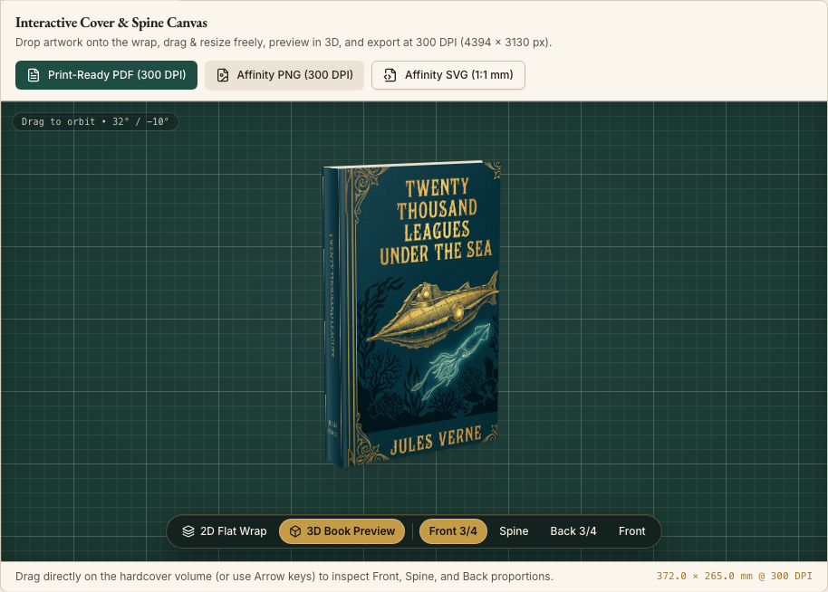

# Bookbinder Studio

Design and print exact **1:1 mm** removable hardcover cases, flexible-spine covers, 1-piece fold-and-glue slip covers, matching inner pockets, and Cricut HTV foil SVGs—all right in your browser. No accounts, no subscriptions, and nothing ever leaves your device.

**[Launch Bookbinder Studio →](https://anujgtm1.github.io/Bookbinder/)**


## What You Can Make

- **Rigid 3-Board Hardcover Cases** — Removable slip-in shells with `9 mm` hinge spacers give your favorite paperbacks an heirloom hardcover look with zero glue or damage to the original cover.
- **Flexible-Spine 2-Board Covers** — Built for thin `3–8 mm` notebooks so your handmade covers open completely flat.
- **1-Piece Fold-and-Glue Slip Covers** — Zero chipboard required, with 4 wrap-over glue tabs, adjustable `20–65 mm` flap width, and 1-click **Fit Letter**, **Fit A4**, and **Deep** presets (an A6 cover fits on a single home printer sheet).

## Measure & Cut Blueprint

- **Book Presets & Units** — Enter custom dimensions with a `mm` / `in` toggle, or start from built-in presets for **A6**, **Mass Market**, **Manga B6**, and **US Trade**.
- **Chipboard Cut Lists & Diagrams** — Get exact board measurements paired with clear visual gluing and folding diagrams.
- **Paper & Roll Fit Checks** — Instantly see if your wrap fits **US Letter**, **A4**, **US Legal**, or **`13"–44"`** roll printers.
- **True-Scale `1:1 mm` CAD Blueprint** — Includes manual cutting dimension chains, a cumulative steel-ruler datum strip, **45° corner miter** callouts, and **grain direction arrows** for leather, paper, and bookcloth.
- **3-Piece Quarter-Bound Split Mode** — Split wider wraps cleanly into separate spine, front, and back pieces for quarter-bound styles or smaller home printers.

## Cover Design Studio

- **Drag-and-Drop Artwork & Color Matching** — Layer `PNG`, `JPG`, `WEBP`, and `SVG` images anywhere on your cover, and sample exact colors with the built-in **eyedropper**.
- **No-Crop Edge Extensions** — Extend cover artwork smoothly across turn-in pasting stubs using **Edge Smear**, **Soft Mirror**, or **Mirror** modes.
- **Cover & Spine Typography** — Add draggable Front/Back titles and Spine text with curated literary fonts or your own uploaded `.ttf`, `.otf`, and `.woff` font files.
- **17 Classic Foil Designs & Custom SVG Stamps** — Dress up your covers with frames, corner flourishes, dividers, emblems, and 6 spine motifs—or import custom vector SVG stamps with **Fill**, **Outline**, and **Thicken** line-weight control.
- **Safe-Margin Snap Guides & Flip** — Snap magnetically to cover centers and balanced margins, use 1-click **Tight**, **Classic**, **Wide**, and **Center** margin fit presets, and apply **Horizontal & Vertical Flip** to art, ornaments, or text.
- **Live Print Preflight** — Catch coverage gaps, low contrast, and optional **DPI** warnings before wasting paper or vinyl.
- **Openable 3D Book Preview & Full Screen** — Orbit your folded book, swing open the front cover in live 3D, or jump into 1-click **Full Screen** focus mode (`Esc` to exit).



## Reusable Series Design Presets

- **Save Once, Reuse Across a Series** — Save any cover style—colors, fonts, text layout, frames, ornaments, and SVG stamps—for matching book sets.
- **Automatic Proportional Refitting** — Apply a saved style to books of different heights, widths, or spine thicknesses and watch every element refit cleanly.
- **Built-In Starter Themes & Sharing** — Includes **4 classic starter series themes**, plus portable `.json` preset export and import for backup or sharing.

## Inner Pockets & Endpapers

- **Mirrored Pockets & Spine Liner** — Auto-generated Front and Back slip-in pocket envelopes with **45° mitered glue flaps** plus a **Spine Reinforcement Liner**.
- **Styled Endpapers & Seamless Patterns** — Pick from curated endpaper swatches, sync in one click with **Match Cover Color**, place draggable/flippable pocket art, or turn any motif into a 1-click seamless **Tile Pattern**.
- **Auto-Paginated Printing** — Export **US Letter**, **A4**, or **Tabloid** PDFs with optional **Print Legend** and **Cut & Fold** lines.
- **Smart Slip-Cover Handling** — Cleanly marked **Built-In** on 1-piece Fold-and-Glue Slip Covers so you never print extra pocket sheets.

## Print & Cutting-Machine Exports

- **300 DPI Print-Ready PDFs** — Crisp vector text, full-bleed artwork, and optional **Cut & Fold** lines ready for home or print-shop output.
- **`1:1 mm` Cut-Only SVGs & PDFs** — Exact-scale cutting outlines for hand knives, plotters, or laser cutters.
- **Affinity Designer Round-Trip SVGs** — Cleanly structured vector SVGs ready for further editing in Affinity Designer.
- **Cricut, Silhouette & ScanNCut HTV & Foil SVGs** — Export **Spine**, **Front Cover**, **Back Cover**, or **Full Wrap** designs with flattened vector paths, weeding box, corner alignment marks, and an **HTV Mirror** toggle.

## Private & Local-First

- Runs 100% offline in your browser—no accounts, no cloud uploads, and no tracking.
- Projects auto-save locally and can be backed up or shared anytime as portable `.json` files.

---

## Running Locally & Docs

Want to run Bookbinder Studio locally or explore the technical docs? Install dependencies with [Node.js 22+](https://nodejs.org/) and `pnpm`, then start the dev server:

```bash
pnpm install && pnpm dev
```

- **[`docs/DEVELOPMENT.md`](docs/DEVELOPMENT.md)** — Tech stack, module layout, scripts, and testing guide
- **[`docs/SPEC.md`](docs/SPEC.md)** — Full millimeter geometry formulas & technical specification
- **[`docs/FEATURE_IDEAS.md`](docs/FEATURE_IDEAS.md)** — Community feature roadmap

Licensed under [MIT](./LICENSE).
