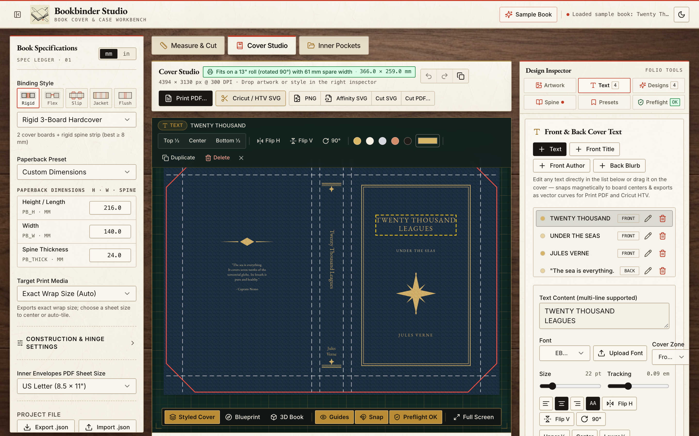

# Bookbinder Studio

Design and print exact **1:1 mm** removable hardcover cases, flexible-spine covers, 1-piece fold-and-glue A6 slip covers, styled inner pockets, and Cricut HTV foil SVGs—all right in your browser. No accounts, no subscriptions, and nothing ever leaves your device.

**[Launch Bookbinder Studio →](https://anujgtm1.github.io/Bookbinder/)**



## What You Can Make

- **Rigid 3-Board Hardcover Cases** — Removable slip-in pockets with `9 mm` hinge spacers give your favorite paperbacks a crisp, heirloom hardcover shell with zero damage to the original cover.
- **Flexible-Spine 2-Board Covers** — Built for thin `3–8 mm` notebooks so your handmade covers open completely flat.
- **1-Piece Fold-and-Glue Slip Covers** — Zero chipboard required, with 4 mitered wrap-over glue tabs and adjustable flap width; an A6 notebook cover fits on **1× US Letter or A4** home printer sheet.

## How It Works

1. **Measure & Cut** — Enter your book's height, width, and thickness (in `mm` or `in`) or pick a built-in preset like A6, Mass Market, Manga B6, or US Trade. Get exact chipboard cuts, roll or home-sheet fit checks, and a `1:1 mm` blueprint with manual cutting rulers for leather, paper, or bookcloth.
2. **Design Your Cover** — Drop in artwork (`PNG`, `JPG`, `WEBP`, `SVG`), place draggable Front/Back cover titles and Spine typography, style matching inner pockets, or add ornaments from 17 classic bookbindery foil designs (frames, corner flourishes, title dividers, and 6 spine motifs) plus your own custom SVG stamps. Orbit your book in live 3D—and even open the front cover—or expand Full Screen to inspect every millimeter closely.
3. **Print or Cut** — Export **300 DPI Print-Ready PDFs** (with optional Cut & Fold guides), **1:1 mm Cut-Only SVGs/PDFs**, **Affinity Designer** round-trip SVGs, or **Cricut / Silhouette / ScanNCut HTV & Foil SVGs** complete with flattened vector text, weeding box, corner alignment marks, and an HTV mirror toggle.


> **100% Private & Local-First:** Everything runs offline in your browser—projects auto-save locally and can be exported or imported anytime as portable `.json` files.

---

## Running Locally & Contributing

Want to run Bookbinder Studio on your own machine or contribute? Install dependencies with [Node.js 22+](https://nodejs.org/) and `pnpm`, then start the local server:

```bash
pnpm install && pnpm dev
```

- **[`docs/DEVELOPMENT.md`](docs/DEVELOPMENT.md)** — Tech stack, module layout, npm scripts, and testing guide
- **[`docs/SPEC.md`](docs/SPEC.md)** — Full millimeter geometry formulas & technical specification
- **[`docs/FEATURE_IDEAS.md`](docs/FEATURE_IDEAS.md)** — Community feature roadmap

Licensed under [MIT](./LICENSE).
