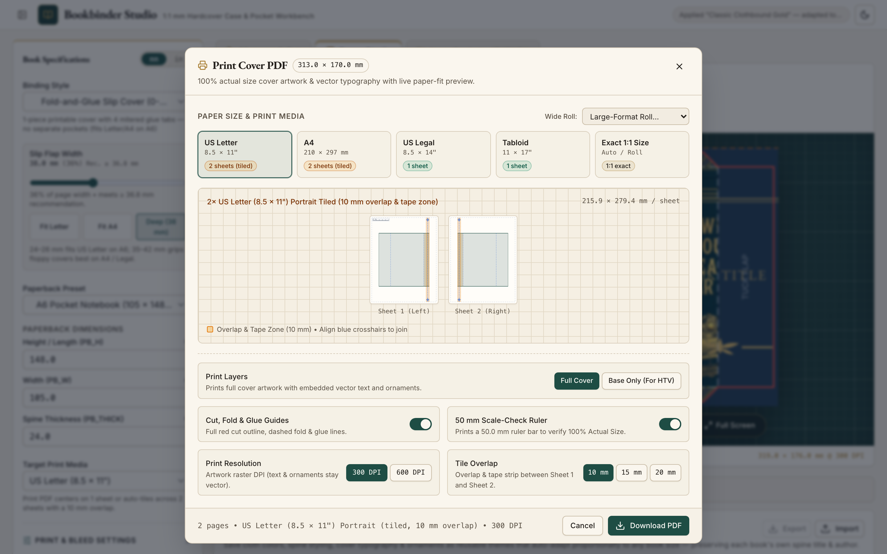

# Bookbinder Studio

Design and print exact **1:1 mm** removable hardcover cases, flexible-spine covers, 1-piece fold-and-glue slip covers, classic dust jackets, replacement paperback covers, matching inner pockets, and Cricut HTV foil SVGs—all right in your browser. No accounts, no subscriptions, and nothing ever leaves your device.

**[Launch Bookbinder Studio →](https://anujgtm.com/Bookbinder/)**


## What You Can Make

| Cover Style | Chipboard | Flaps / Inner Pockets | Best For |
| --- | --- | --- | --- |
| **Rigid 3-Board Hardcover** | Front, Back & Spine boards (`9 mm` hinges) | Separate slip-in pockets + spine liner | Removable heirloom hardcovers (`≥ 8 mm` spines) with zero damage to the paperback |
| **Flexible-Spine 2-Board** | Front & Back boards + cloth spine gap | Separate slip-in pockets + spine liner | Thin `3–8 mm` notebooks & chapbooks that need to open completely flat |
| **Fold-and-Glue Slip Cover** | None (`0` boards) | Built-in `20–65 mm` flaps + 4 wrap-over glue tabs | 1-piece printable slip-in covers with closed pockets (fits `1× US Legal` or `2× US Letter`, and `1× US Letter` on tight A6) |
| **Classic Dust Jacket** | None (`0` boards) | Adjustable `20–100 mm` fold-in flaps (no glue) | Publisher-style wrap-around dust jackets with 4 vertical score folds |
| **Replacement Paperback Cover** | None (`0` boards) | Flush trim (none needed) | 1-piece cardstock wraps (`Back + Spine + Front`) glued directly onto a paperback textblock spine |

## Measure & Cut Blueprint

- **Book Presets & Units** — Enter custom dimensions with a `mm` / `in` toggle, or start from built-in presets for **A6**, **Mass Market**, **Manga B6**, and **US Trade**.
- **Chipboard Cut Lists & Diagrams** — Exact board measurements, score stops, material guidance, and visual gluing/folding diagrams tailored to each binding style.
- **Smart Flap-Depth Guardrails** — Live recommended minimum flap depth right beside the flap slider (`≥ 35%` / `35 mm` floor for glued Slip Covers; `≥ 45%` / `45 mm` floor for unglued Dust Jackets) with 1-click **Fit Letter**, **Fit A4**, **Deep (38 mm)**, and **Classic (70 mm)** presets.
- **Paper & Roll Fit Checks** — Instantly see whether your wrap fits **US Letter (`8.5 × 11"`)**, **A4 (`210 × 297 mm`)**, **US Legal (`8.5 × 14"`)**, **Tabloid (`11 × 17"`)**, or **`13"–44"`** roll printers with live `1 sheet` vs. `2 sheets (tiled)` status badges.
- **True-Scale `1:1 mm` CAD Blueprint** — Manual cutting dimension chains, a cumulative steel-ruler datum strip, **45° corner miter** callouts, and **grain direction arrows** for leather, paper, and bookcloth.
- **3-Piece Quarter-Bound Split Mode** — Split wider hardcover wraps cleanly into separate spine, front, and back pieces for quarter-bound styles or smaller home printers.


## Cover Design Studio

- **Drag-and-Drop Artwork & Zone-Aware Fit** — Layer `PNG`, `JPG`, `WEBP`, and `SVG` images anywhere on your cover, sample exact colors with the built-in **eyedropper**, and use **Fit Front** / **Fit Back** (automatically framing the visible cover face without spilling onto tuck flaps or glue tabs) or **Fit Full Wrap**.
- **No-Crop Edge Extensions** — Extend cover artwork smoothly across hardcover turn-in pasting stubs using **Edge Smear**, **Soft Mirror**, or **Mirror** modes.
- **Cover & Spine Typography** — Add generic **`+ Text`**, **Front Title**, **Front Author**, **Back Blurb**, and **Spine** lettering with inline list renaming (synced `1:1` with the cover), curated literary fonts, or your own uploaded `.ttf`, `.otf`, and `.woff` font files.
- **17 Classic Foil Designs & Custom SVG Stamps** — Dress up your covers with frames, corner flourishes, dividers, emblems, and 6 spine motifs—or import custom vector `.svg` stamps with **Fill**, **Outline**, and **Fill + Thicken** line-weight control.
- **Safe-Margin Snap Guides & Flip** — Snap magnetically to cover centers and balanced margins, use 1-click **Tight**, **Classic**, **Wide**, and **Center** margin fit presets, and apply **Horizontal & Vertical Flip** to artwork, ornaments, or text.
- **Live Print, Paper-Fit & Flap-Depth Preflight** — Catch board coverage gaps, shallow flaps (highlighted directly on the 2D canvas), low spine contrast, optional **DPI** warnings, and paper-fit overflows before wasting paper or vinyl—each with **1-click fixes**.
- **Openable 3D Book Preview, Full Screen & Atelier Themes** — Orbit your folded book, swing open the front cover in live 3D, expand any canvas into **Full Screen** focus mode (`Esc` to exit), and switch between warm Light and Dark atelier themes.


## Reusable Series Design Presets

- **Save Once, Reuse Across a Series** — Save any cover style—colors, fonts, text layout, frames, ornaments, and SVG stamps—for matching book sets.
- **Automatic Proportional Refitting** — Apply a saved style to books of different heights, widths, or spine thicknesses and watch every element refit cleanly.
- **Built-In Starter Themes & Sharing** — Includes **4 classic starter series themes**, plus portable `.json` preset export and import for backup or sharing.

## Inner Pockets & Endpapers

- **Mirrored Pockets & Spine Liner** — Auto-generated Front and Back slip-in pocket envelopes with **45° mitered glue flaps** plus a **Spine Reinforcement Liner**.
- **Styled Endpapers & Seamless Patterns** — Pick from curated endpaper swatches, sync in one click with **Match Cover Color**, place draggable/flippable pocket art, or turn any motif into a 1-click seamless **Tile Pattern**.
- **Auto-Paginated Printing** — Export **US Letter (`8.5 × 11"`)**, **A4 (`210 × 297 mm`)**, **US Legal (`8.5 × 14"`)**, or **Tabloid (`11 × 17"`)** PDFs with an optional **`50 × 50 mm` Calibration & Legend** block and **Cut & Fold** lines.
- **Smart Cover-Style Handling** — Cleanly marked **Built-In** on Fold-and-Glue Slip Covers and **Not Needed** on Classic Dust Jackets & Replacement Paperback Covers so you never print extra pocket sheets.


## Print & Cutting-Machine Exports

- **Unified Print & Export PDF Dialog** — Clicking any PDF button in **Cover Studio**, **Measure & Cut**, or **Inner Pockets** opens a dedicated Export Dialog where you can compare paper sizes live (`US Letter (8.5 × 11")`, `A4 (210 × 297 mm)`, `US Legal (8.5 × 14")`, `Tabloid (11 × 17")`, `Exact 1:1 Size`, or `13"–44"` rolls) with instant **`1 sheet`** vs. **`2 sheets (tiled)`** fit badges, a live sheet-layout preview, and **1-click fixes** whenever a cover exceeds your chosen sheet.
- **Flexible Multi-Sheet Tiling & Calibration** — Choose between printing on a single larger sheet (e.g., `1× US Legal`) or tiling across `2× US Letter / A4` sheets with configurable overlap (`10 / 15 / 20 mm`), shaded tape-zone guides, blue alignment crosshairs, and an optional **`50 mm` Scale-Check Ruler** bar to verify 100% actual size before cutting.
- **`300 / 600 DPI` Print-Ready Cover PDFs** — Crisp embedded vector text and ornaments over `300` or `600 DPI` full-bleed artwork, with **Cut, Fold & Glue Guides** or clean **Registration Marks Only**, plus **Single Wrap** or **3-Piece Split** output.
- **Hybrid Printed Base + Cricut HTV Foil Workflow** — Switch **Print Layers** to **Base Only (For HTV)** (`outer_cover_base_for_htv.pdf`) to print background artwork with outer `3 mm` center-alignment ticks and zero double-vision text ghosting, or jump straight there from the **Export Printed Base PDF…** button inside the Cricut dialog.
- **Cricut, Silhouette & ScanNCut HTV & Foil SVGs** — Preview vector cut paths on a crisp high-contrast carrier mat (readable in Dark & Light themes), export **Spine**, **Front Cover**, **Back Cover**, or **Full Wrap** designs with flattened glyph paths (zero `<text>` tags), weeding box, corner alignment marks, **HTV Mirror**, and **Split Mats by Foil Color** so Design Space separates multi-color foil designs automatically.
- **Auto-Paginated Inner Pockets PDFs** — Packs pockets and spine liner across `US Letter`, `A4`, `US Legal`, or `Tabloid` pages with an optional **`50 × 50 mm` calibration square & legend**.
- **`1:1 mm` Cut-Only SVGs, PDFs & Affinity Round-Trip SVGs** — Exact-scale cutting outlines for hand knives, plotters, or laser cutters, plus cleanly layered SVGs ready for further editing in Affinity Designer.




## Private & Local-First

- Runs 100% offline in your browser—no accounts, no cloud uploads, and no tracking.
- Projects auto-save locally and can be backed up or shared anytime as portable `.json` files.

---

## Running Locally & Docs

Want to run Bookbinder Studio locally or explore the technical docs? Install dependencies with [Node.js 22+](https://nodejs.org/) and `pnpm`, then start the dev server:

```bash
pnpm install && pnpm dev
```

- **[`docs/DEVELOPMENT.md`](docs/DEVELOPMENT.md)** — Tech stack, module layout, scripts, and testing guide
- **[`docs/SPEC.md`](docs/SPEC.md)** — Full millimeter geometry formulas & technical specification
- **[`docs/FEATURE_IDEAS.md`](docs/FEATURE_IDEAS.md)** — Community feature roadmap

Licensed under [MIT](./LICENSE).
