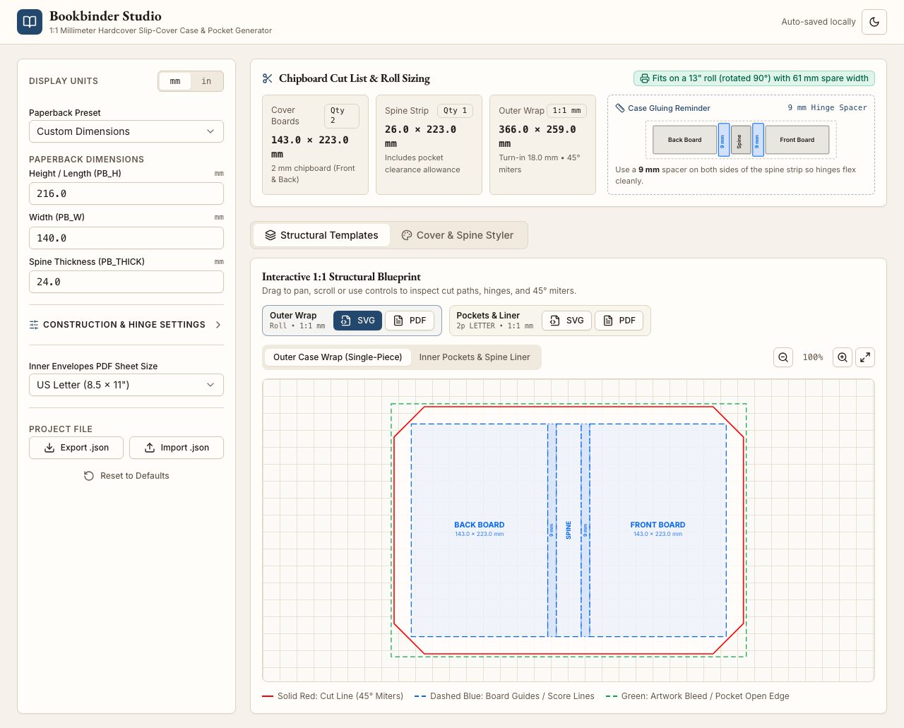

# Bookbinder Studio

A client-side web application for DIY bookbinders to generate exact **1:1 millimeter-accurate templates** and **300 DPI print-ready wraps** for **removable hardcover slip-cover cases**—designed to house existing paperbacks without damaging or removing their original covers.



## Features

### Phase 1 — Structural Geometry & 1:1 mm Templates
- **Paperback Presets & Unit Toggle:** Built-in presets (Mass Market, US Trade Digest, US Trade Standard, Manga / B6) or custom dimensions with instant `mm` ↔ `in` switching (stored internally at full millimeter precision).
- **Exact Chipboard Cut List & 9 mm Hinge Spacer Guide:** Live dimensions for **2× Cover Boards**, **1× Spine Strip**, **Outer Wrap**, an inline SVG gluing reminder diagram, and a **Roll Printer Width & Orientation Evaluator** (checking `13"`–`44"` rolls in both unrotated and 90°-rotated feeds).
- **Interactive 1:1 Blueprint:** Zoomable, pannable SVG blueprint for both the **Outer Case Wrap** (Single-Piece Continuous or 3-Piece Quarter-Bound Split with exact 45°-mitered corners and optional bleed) and **Inner Pockets & Spine Liner** (with 45°-mitered glue flaps and open-edge callouts).
- **2 × 2 Structural Export Matrix:**
  - **Outer Case Wrap:** `.SVG` (1:1 mm Affinity-ready named layers) and `.PDF` (1:1 mm vector print template).
  - **Inner Pockets & Spine Liner:** `.SVG` (1:1 mm vector cut/score/glue layers) and `.PDF` (auto-paginated/auto-rotated across US Letter, A4, or Tabloid with a `50 × 50 mm` calibration square).
- **Local Auto-Save & Project JSON:** Automatic `localStorage` persistence plus portable `.json` project export/import.

### Phase 2 — Interactive Cover & Spine Styler


- **Free-Form Multi-Image Canvas:** Upload or drag-and-drop as many PNG, JPG, or WEBP images as you like (front art, back art, spine emblems, full-wrap panoramas). Click to select, drag anywhere across the book, pull any of the 4 corner handles (or scroll) to resize proportionally, reorder z-index layers, snap with one-click **Quick Fit** (`Front`, `Spine`, `Back`, `Full Wrap`), and apply optional per-zone clip masks.
- **Zone Background Colors & Eyedropper:** Pick solid base colors for Back, Spine & Hinges, and Front zones—or click anywhere on your uploaded artwork with the **Eyedropper** to sample an exact matching tone.
- **Spine Typography:** Separate Title & Author fields, **Inline** vs. **Stacked** layouts, **Top-to-Bottom (US/UK)** vs. **Bottom-to-Top (European)** reading orientations, 6 bundled offline classic literary fonts (*EB Garamond, Libre Baskerville, Cormorant Garamond, Lora, Inter, Montserrat*), custom `.ttf`/`.otf`/`.woff`/`.woff2` uploader, automatic font-size clamping (`≤ SPINE_W - 4.0 mm` to clear the 9 mm hinges), and a `±2.0 mm` optical horizontal nudge.
- **300 DPI Dual Exports:**
  - **Print-Ready Roll PDF (`outer_cover_print.pdf`):** 300 DPI composited artwork + true embedded vector spine typography + toggle between *Bleed + Outer Corner Registration Marks Only* and *Full Cut & 45° Miter Hairline Guides*.
  - **Affinity Round-Trip (`outer_cover_300dpi.png` & `outer_cover_300dpi.svg`):** Exact 1:1 mm / 300 DPI flat cover + editable SVG layers for further graphic finishing in Affinity.

---

## Quick Start

Requires Node.js 22+ and `pnpm`.

```bash
pnpm install
pnpm dev
```

### Scripts

| Command | Description |
| --- | --- |
| `pnpm dev` | Start local Vite dev server |
| `pnpm build` | Type-check and build production static bundle to `dist/` |
| `pnpm typecheck` | Run strict TypeScript checking (`tsc -b --noEmit`) |
| `pnpm lint` | Run ESLint across the codebase |
| `pnpm test` | Run Vitest unit and component tests |
| `pnpm test:coverage` | Run Vitest with v8 coverage report |
| `pnpm test:e2e` | Run Playwright Chromium end-to-end behavioral tests |

---

## Project Architecture

```text
src/
├── types/          # Domain types with co-located serialize/deserialize/validate/math models
├── core/           # Pure 1:1 mm geometry engine, SVG & PDF exporters, storage, theme
├── studio/         # Decoupled Phase 2 interactive cover/spine compositor & 300 DPI render engine
└── components/     # shadcn/ui Radix primitives + SidebarControls, CutListCard, BlueprintPreview
docs/
├── SPEC.md         # Full technical specification & millimeter geometry formulas
├── ROADMAP.md      # Completed milestones, next features, and backlog
├── DEPLOYMENT.md   # GitHub Pages static CI/CD deployment guide
└── RESEARCH.md     # Affinity Connector research (JS Scripting API & MCP)
```

---

## Documentation

- [Project Specification](./docs/SPEC.md)
- [Feature Roadmap & Tracker](./docs/ROADMAP.md)
- [GitHub Pages Deployment Guide](./docs/DEPLOYMENT.md)
- [Affinity Connector Research](./docs/RESEARCH.md)

## License

[MIT](./LICENSE)
